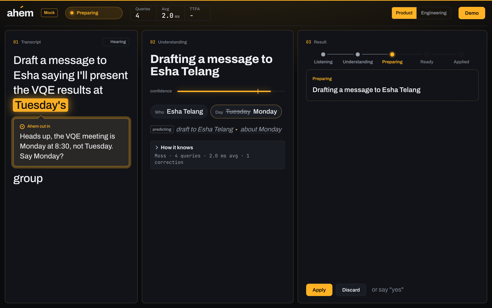
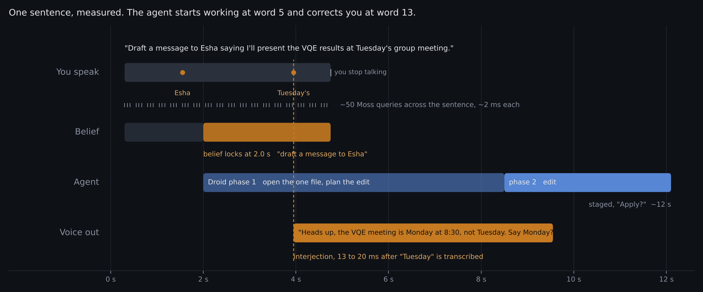
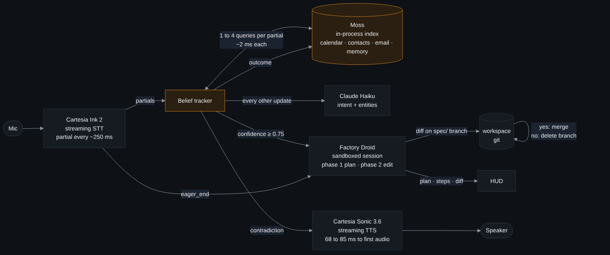
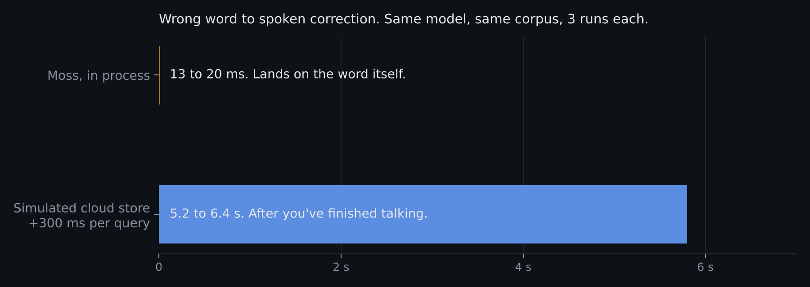

# Ahem

**Speculative execution for conversation.** Ahem runs retrieval, intent, and action continuously against your partial sentence, commits to a guess before you finish, rolls back if you diverge, and cuts in when what you're saying contradicts what it knows. A voice assistant is the first thing I built on it.

Built solo at Cal Hacks 13.0 in about 36 hours. Runs on my real Berkeley calendar and inbox.

## The problem with how AI listens

Every AI system today runs on a request-response loop. You produce a complete input. Then it thinks. Then it acts. Voice makes that loop painful because speech is slow and the pause after you stop talking is dead time. But the deeper problem is that the loop locks in mistakes. By the time a model acts on "tell Esha I'll see her at Tuesday's meeting," the wrong day is already in the draft. Nothing in a request-response system can catch an error while you're making it, because nothing is running while you're talking.

People don't work like that. A friend who knows your calendar cuts in at the word "Tuesday." They were already thinking about the meeting while you were mid-sentence. That gap between how people help each other and how software does is what I wanted to close, and I didn't think a better assistant would close it. The loop itself had to change.

## The idea

Treat the sentence as a stream, not a message. Run the whole stack against the partial input, continuously, and let the system commit to a guess before the input is complete.

That's speculative execution, and CPUs have done it for thirty years. A processor doesn't wait to learn which branch a program takes. It predicts, starts executing down that path, and if it guessed wrong it throws the work away and nobody notices. Ahem does the same thing with a conversation. The belief tracker is the branch predictor. A coding agent working on a git branch is the speculative execution unit. Rollback is the pipeline flush. The commit on "yes" is retirement.

Three things have to exist for this to work.

**Retrieval fast enough to run on every partial.** A belief needs evidence, dozens of times per sentence. That only works with retrieval inside the process. I measured the alternative. With a simulated 300 ms cloud store the system's correction lands 5 to 6 seconds after you've stopped talking. With in-process retrieval at about 2 ms it lands 13 to 20 ms after the word is transcribed.

**A speech layer that exposes the stream.** Partials every 250 ms, an early end-of-turn signal to commit on, a resume signal to un-commit, and speech out fast enough to interrupt a person mid-word.

**An executor that can start on a guess and leave no trace when wrong.** Scoped permissions, a branch per speculation, a visible plan and diff, and a rollback that costs nothing.

Once those exist, the interjection falls out for free. A live belief checked against ground truth every 250 ms notices a contradiction at the word where it happens, and the system can speak up right then. A request-response assistant structurally can't do that.

## What it looks like



Say "Draft a message to Esha saying I'll present the VQE results at Tuesday's group meeting." At "Tuesday" Ahem says, out loud, "Heads up, the VQE meeting is Monday at 8:30, not Tuesday. Say Monday?" You say yes. The corrected draft is already staged because the agent started on it at the word "Esha."

Say "Move my SETI research meeting to Wednesday afternoon." The belief locks at "SETI," the agent opens that one calendar file and plans the edit while you finish the sentence, and when you stop it asks "Apply?" with the diff on screen. Say no and the branch is gone.

Say "Find the SETI slides, actually never mind, when is my Math 52 homework due?" and you watch the system start down one path, roll back, and answer the real question. Mispredictions are shown, not hidden. Then ask "What did I tell Esha?" and it recalls the draft from a minute ago, because everything it does is written back into the same memory it reads from.

Everything is reversible and visible. Every change is a diff on a branch. It never acts without asking, and it asks twice for anything that touches your data.

## How it works





```
mic → Ink 2 (streaming STT) → partial every ~250 ms
         ↓
   belief tracker: 1 to 4 Moss queries per partial (in process, ~2 ms each)
                   + a Haiku intent call every other update
         ↓
   contradiction? → Sonic speaks the interjection, mic mutes, you answer
   confident?     → Droid session opens the exact file and plans (phase 1)
         ↓
   Ink eager_end  → Droid applies the edit (phase 2) → diff on a spec/ branch
         ↓
   "Apply?" → yes merges to main, no deletes the branch
         ↓
   turn and outcome written back into Moss as memory
```

One Node process. No database. The only store is Moss.

## Technologies

I picked these four because each one removes a wall I couldn't get past otherwise. Take any one away and Ahem stops being Ahem.

### Moss

Without Moss there is no belief, and without a belief there's nothing to speculate on.

The belief tracker needs evidence on every partial transcript. That's one to four searches every 250 ms, around 50 per sentence. I tried the obvious thing first, a vector store behind an HTTP call, and the math doesn't work. At 300 ms a query the searches pile up behind each other and the correction arrives five seconds after you've stopped talking. The HUD has a toggle that simulates exactly that so you can watch it fail. Moss runs inside the server process, so a query is about 2 ms and the belief keeps up with speech.

So Moss became the only data layer. My calendar, contacts, and recent email get indexed once and loaded at startup. There's no database behind it and no cache in front of it. I considered that layout and dropped it. When retrieval is the hot path, the index is the store.

It's also where memory lives. After every turn I upsert the transcript, the belief, and what happened into a second in-process session index. After every commit, the thing that got committed goes in too. That's why "What did I tell Esha?" works a minute later, and why it still works after a restart.

### Cartesia

Without Cartesia there's no stream to speculate on, and no way to interrupt anyone.

Ahem only works if the speech layer hands over the sentence as it's being said. Ink 2's streaming WebSocket does that, with a cumulative transcript every 250 ms or so. It also sends an `eager_end` signal 100 to 350 ms before the turn formally ends, and that's the trigger for committing the speculation. `resume` undoes it if you keep talking. I'd have had to build turn detection myself without those two events, and I would have built it worse.

The interjection needs speech out that's faster than a person's reaction. Sonic 3.6 over the streaming WebSocket, with a socket warmed when the browser connects, gets first audio in 68 to 85 ms. That's the difference between the agent cutting in and the agent responding. While it talks, a server-side playback clock mutes the mic so Ink never hears Sonic.

I went to the models directly instead of using the managed agent platform because the whole product lives inside the turn. Acting on partials and interrupting mid-sentence means I had to own the STT stream and the turn logic. Ink writes "two" as "2" and adds commas, so matching normalizes text first. Keys stay in `.env` on the server and never touch the browser.

### Factory Droid

Without Droid the belief is just a prediction. Droid is what makes it an action, and what makes the action safe to take on a guess.

The trigger is the belief tracker's confidence crossing 0.75, mid-sentence. There's no chat window anywhere. A warm Droid session gets `cwd` pointed at a workspace outside the repo and a two-part job. Phase one opens exactly one file and plans. Phase two, fired on `eager_end`, makes the edit. Every tool call, plan step, and result streams to the HUD, and the diff shows up the moment the edit lands.

Letting a coding agent loose on my real calendar meant confinement had to be layered. Droid's sandbox denies reads outside the workspace. The tool allowlist is Create, Edit, Read, TodoWrite, ToolSearch. A watchdog looks at every tool call and kills the session on any path outside the workspace or any tool off the list, and the HUD shows the denied call in red. The CLI gets an allowlisted environment, because the SDK otherwise hands it every variable on the server, API keys included. I put a canary secret two directories up and tried to make Droid read it. It couldn't.

Each speculation is a git branch. Yes fast-forwards main. No deletes the branch. If your sentence changes direction while Droid is working, the branch disappears and the HUD shows the rollback. That's what lets the agent start early.

### Claude Haiku

Haiku turns a partial sentence plus the top Moss hits into intent, entities, and claims as strict JSON. It takes 1.2 to 1.6 s, which is too slow for every partial, so it runs every other update and never blocks the Moss loop. The interjection timing comes from fast rule checks on weekday and time, with Haiku's claims as a second source.

## Numbers (all measured, details in `docs/sdk-notes.md`)



| | |
|---|---|
| Moss query, warm | ~2 ms p50 |
| Queries per utterance | ~50 |
| Interjection lag after the wrong word, Moss | 13 to 20 ms |
| Same, simulated 300 ms cloud store | 5.2 to 6.4 s |
| Sonic time to first audio | 68 to 85 ms |
| Belief lock | ~2 s into the sentence |
| Belief lock to staged diff | 8 to 14 s (phase one overlaps your speech) |

## Setup

```bash
pnpm install
cp .env.example .env     # Cartesia, Moss, Factory, Anthropic keys
pnpm -r build
pnpm reset:workspace     # synthetic workspace with demo facts
pnpm --filter @ahead/server dev
pnpm --filter @ahead/web dev   # http://localhost:5173
```

To run on your own Google Calendar and Gmail, see `docs/google-setup.md`. The import is read-only, redacts email addresses, and skips sensitive subjects. `DEMO_MODE=1` replays recorded transcripts through the full live stack when there's no mic.

## Known limitations

The mic is muted while the agent speaks, so you can't talk over it. Spoken yes and no have a 6 second window, with buttons and keyboard shortcuts as a fallback. Ink sometimes opens an empty "phantom" turn after silence, which the server filters. One interjection per turn by design. Staging waits on a coding agent doing three model round trips, so there's a 5 to 8 second pause after you stop talking before "Apply?" Droid occasionally paraphrases a draft, so dictated text after "saying" is passed through word for word. The demo facts are tied to this week's calendar.

## Accessibility, privacy, and responsible use

Ahem works without a screen. Every spoken line is also shown as a caption for noisy rooms and for people who can't hear it.

Your corpus is uploaded once to Moss to build the index and then lives inside the server process. Audio goes to Cartesia. The top retrieval snippets for each utterance go to Haiku. Droid sees only the workspace files it's told to open. Email addresses are redacted before anything is indexed. Nothing is ever sent on your behalf. Drafts are files on your disk.

The agent never acts alone. It asks before applying a correction and again before applying a change. Every change is a diff you can read, on a branch you can throw away. Mispredictions are shown as rollbacks, not hidden.

## What's next

Real send and calendar write-back behind the same confirm flow. A wearable or earbud form factor, since the screen is already optional. More interjection types, starting with schedule conflicts.
